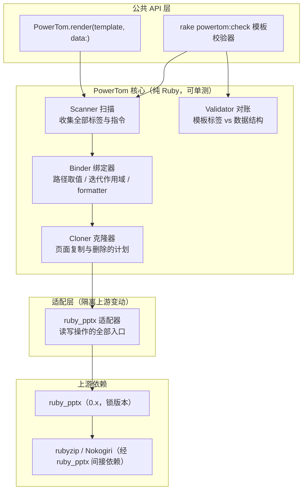

# PowerTom：Ruby PPTX 模板引擎 · 项目设计文档

> 名称 PowerTom，模块 `PowerTom`，gem 名 `powertom`。版本 v0.1 草案，2026-11-16。

## 1. 项目定位

### 1.1 一句话定位

设计师在 PowerPoint 里维护模板，工程师传一个 Ruby Hash，产出成品 deck。模板的排版、字体、母版、主题完全由设计工具掌控，代码只负责"扫描标签、绑定数据、克隆页面"。

### 1.2 要解决的问题

Ruby 生态中 PPTX 生成有两类现有方案，都不适合"设计资产复用"场景：

| 方案 | 代表 | 问题 |
| --- | --- | --- |
| 代码驱动 | `powerpoint`、`ruby_slides`、`caracal`（docx 同思路） | 排版写死在代码里，设计师改一个字号要走开发流程 |
| 底层库 | `ruby_pptx`（2026-09 发布，python-pptx 移植）、`rbpptx`（2026-04 发布，只读写） | 提供 XML 级积木，没有模板层；让设计师直接面对代码不现实 |

JS 世界的 Carbone 和 Docxtemplater 已验证"模板 + JSON 数据 → PPTX"有真实商业需求，Ruby 没有对应物。PowerTom 补的是这一层：**站在 ruby_pptx 肩上的模板引擎**，不自己解析 OOXML。

### 1.3 非目标（v1 明确不做）

- 不做"代码里声明式搭整份 deck"（ruby_pptx 的 `Pptx.build` 已覆盖）
- 不做 PPT → PDF 转换（交给 LibreOffice headless）
- 不做 PPT（97-2003 二进制格式）读写，只支持 OOXML 的 .pptx
- 不做协同编辑、批注等产品化功能

## 2. 核心抽象与目标 API

### 2.1 渲染入口

```ruby
require "powertom"

result = PowerTom.render(
  "templates/annual_report.pptx",
  data: {
    title: "2026 年度总结",
    quarter: "Q4",
    kpis: [
      { name: "领养率", value: "29.7%", delta: "+3.2pt" },
      { name: "月活校区", value: "86", delta: "+12" }
    ],
    show_outlook: true
  }
)

result.save("out/annual_report_2026.pptx")
result.warnings.each { |w| puts w }   # 未使用的字段、被截断的文本等
```

### 2.2 数据模型约定

- 顶层是任意嵌套的 Hash / Array / 标量，String 用 `to_s`，数字用 `to_s`（格式化交给模板里的 formatter，见 3.4）
- nil 值：文本标签渲染为空字符串；条件标签视为假
- 日期时间：接受 `Date` / `Time` / `DateTime`，格式化由 formatter 决定

### 2.3 错误模型

| 场景 | 行为 |
| --- | --- |
| 模板引用了数据中不存在的字段 | 默认抛 `PowerTom::MissingDataError`（含页码与文本框名），`strict: false` 时降级为填空字符串并记 warning |
| 数据有模板未使用的字段 | 记 warning，不报错 |
| 标签语法错误（如 `{{each kpis}}` 缺 `#`） | 渲染前扫描阶段抛 `PowerTom::TemplateSyntaxError` |
| ruby_pptx 打不开文件 / 不是 pptx | 透传包装为 `PowerTom::InvalidTemplateError` |

错误信息一律带定位：第几页（幻灯片序号）、哪个形状（name 属性）、原始标签文本。这是模板引擎能否被设计师独立使用的关键。

## 3. 模板语法规范（v0）

### 3.1 设计原则

1. **指令放备注，标签放正文**：放映时备注不可见，设计师制作模板时可见，不污染画面
2. 标签语法只有一种定界符 `{{ }}`，不引入 Jinja2/ERB 的全套控制流
3. 标签写在哪个 run，替换后就继承哪个 run 的样式。占位文本的样式就是成品样式

### 3.2 文本标签

```text
{{title}}
{{kpis[0].value}}
```

只支持点路径与下标，不支持方法调用、表达式、管道。路径即数据结构的镜像，模板评审时肉眼可对账。

### 3.3 页级指令（写在幻灯片备注里）

```text
{{#each kpis}}      # 按数组克隆整页，页内标签取每次迭代的作用域
{{#if show_outlook}}  # 为假时删除整页
```

- 一页备注只允许一条指令；多条时扫描阶段报错
- `#if` 可与 `#each` 之外的任意标签共存
- 普通文本标签仍可写在备注里（备注本身也要渲染的情况很少，v0 不支持，记 warning）

### 3.4 Formatter（可选，第二期）

```text
{{price:currency}}
{{ratio:percent.1}}
{{date:year_month}}
```

冒号后的词映射到 Ruby 侧注册的 formatter proc，内置 currency / percent / number / date 四族，支持用户注册自定义。v0 先不做，占位文本由调用方自行 `to_s`。

## 4. 架构



分层要点：

- **Scanner / Binder / Validator 不碰 XML**，输入输出是纯 Ruby 结构（标签 AST + 数据），可以高速单测
- 适配层是唯一 import `ruby_pptx` 的文件。上游 1.0 前 API 会变，变动被锁在一个模块里
- 渲染流程：扫描（全文件收集标签）→ 校验对账 → 生成"编辑计划"（替换哪些文本、克隆哪些页、删哪些页）→ 由适配层一次性执行 → 保存

## 5. 技术要点与已知坑

### 5.1 Run 分裂（头号坑）

PowerPoint 会把 `{{title}}` 存成多个 run：输入法组合、拼写检查、反复编辑都会触发。表现是 `{{ti` + `tle}}` 分属两个 `<a:r>`。

解法：在**段落级**把所有 run 的文本拼接成完整字符串，正则匹配标签，替换时写回首个 run 并清空其余 run 的文本（保留 run 节点本身，避免破坏样式引用）。这是 v0 必须在第一天解决并写满测试用例的问题。

### 5.2 幻灯片克隆

克隆一张 slide 需要：复制 slide part 与 notes part、为新 part 重建全部 relationship（图片、媒体、notesSlide 关联）、在 `presentation.xml` 的 `sldIdLst` 插入新 `sldId`（新 id 与 rId）、更新 `[Content_Types].xml`。

原则：这块 XML 细节尽量让 ruby_pptx 干，PowerTom 只声明"第 N 页按某数组克隆 K 份"。**已核对上游 0.2.0 源码：`Slides#add_table_pages` 是逐页 `add(layout)` 后新建表格，不含任何 slide part 复制；`Slides` 也没有 delete / duplicate。** 所以克隆与删页要在适配层基于 `Opc::Part#relate_to / rels` + `Oxml::BaseElement#import` 自己实现。另有一个隐性约束：`next_slide_partname` 以 `sldIdLst.size + 1` 命名，删页后不 `renumber_slide_parts` 会与现有 part 撞名。上游缺能力时先提 PR，PowerTom 侧不私藏 XML 操作，防止适配层渗透。

### 5.3 图片替换

占位图片按形状 name 或 alt text 定位（约定 name 为 `powertom:image:字段名`），替换 media part 时保持扩展名与 content type 一致，纵横比策略 v0 固定为"填满形状、居中裁切"（等比缩放由 ruby_pptx 的裁剪属性实现），不做可配置。

### 5.4 图表数据绑定（v1.0 之后的候选）

数据驱动 `c:ser` 的系列值与类别名。难点是 series 数量与模板不一致时要增删 `c:ser` 节点并维护 `c:idx` / `c:order`。放在最后，因为它可能更适合做成独立 gem（powertom-charts）或上游 PR。

### 5.5 保真验收

产出文件在 PowerPoint 打开不能弹"修复"对话框。CI 策略：每个金样本模板渲染后用 LibreOffice headless 转 PDF，转换成功 + 页数正确 + PDF 文本抽查含预期值，三重断言。LibreOffice 比 PowerPoint 宽松，所以还要保留一个人工验收清单（每加一个金样本，人工用真实 PowerPoint 开一次）。

## 6. 里程碑

| 阶段 | 内容 | 验收标准 |
| --- | --- | --- |
| M0 · 第 1 周 | 解剖真实 pptx 的 run 结构；ruby_pptx 读写跑通；run 分裂复现 | 50 行脚本：读模板、替换一个标签、PowerPoint 正常打开 |
| M1 · 第 2-3 周 | Scanner + Binder + 段落级 run 合并替换；金样本 1（单页多标签） | 金样本渲染通过 CI；标签跨 run 也能替换 |
| M2 · 第 4-6 周 | `#each` 页面克隆、`#if` 页面删除；错误模型与定位信息 | 金样本 2（循环页）通过；错误信息含页码与形状名 |
| M3 · 第 7-8 周 | Validator 对账 + `rake powertom:check` + warnings | 坏模板在 CI 阶段报错，报错可指导设计师自查 |
| M4 · 第 9-10 周 | 图片替换；formatter；狗粮：在公司产品里接一个真实导出场景 | 真实业务出图，设计师改模板不需要开发介入 |
| 1.0 之后 | 图表绑定、Docxtemplater 兼容层（评估）、独立网站与文档 | 按狗粮反馈排 |

里程碑之间不追求库的完整性，追求每个阶段都有"能拿去真的用"的输出。

## 7. 模板校验器（差异化核心）

竞品普遍把校验当作日志的副产品，PowerTom 把它做成一等公民：

- **`powertom:check`** 输入模板 + 一个样例数据（或数据 schema），输出人话报告：每条问题给出"第 X 页、形状 Y、标签 Z、期望的数据路径"
- 报告分两级：error（引用了不存在的字段、指令语法错）阻断渲染；warning（未使用的字段、占位文本疑似超长）不阻断
- 附一份《模板制作规范》（设计师读）：母版使用约定、占位文本建议长度（autofit 关闭时文字溢出不裁）、命名约定 `powertom:image:*`
- 设计师视角的"模板 lint"是本项目相对 JS 竞品最可持续的差异点，规范文档本身是护城河的一部分

## 8. 测试与质量策略

- **金样本（golden fixtures）**：真实 PowerPoint 制作，覆盖：单页多标签、跨 run 标签、循环页、条件页、中文字体、图表页（后期）。每个金样本 = 模板 + 数据 + 断言（页数、关键文本、LibreOffice 转 PDF 成功）
- **单元层**：Scanner / Binder / Validator 不依赖文件 I/O，纯结构进出，目标覆盖率 > 90%
- **回归双保险**：LibreOffice headless 转换 + `ruby_pptx` 重新读回断言（读回能证明包结构自洽）
- **模糊输入**：`strict: false` 下标签缺失、数据为 nil、数组为空（循环页应为 0 页时整组删除）都要有明确语义测试

## 9. 风险与应对

| 风险 | 概率 | 应对 |
| --- | --- | --- |
| ruby_pptx 处于 0.x，API 变动 | 高 | 适配层单文件隔离 + Gemfile 锁版本 + 每次升级跑全量金样本 |
| 幻灯片克隆在上游能力不足 | 中 | M2 前先做 spike；不足则给 ruby_pptx 提 PR（克隆是通用需求，上游有动机收） |
| LibreOffice 校验宽于 PowerPoint，坏文件漏网 | 中 | 金样本人工过一遍真实 PowerPoint；条件允许加一个 Windows/PowerPoint 的 CI job |
| 设计师不遵守规范导致诡异模板 | 中 | check 工具 + 规范文档 + 报错定位到形状 name，把自查成本压到最低 |
| Keynote / WPS 用户存出的非标准 pptx | 低 | 打开失败时明确报"请用 PowerPoint / LibreOffice 另存"，不追求全兼容 |
| 与 Carbone 等成熟方案比功能少 | 确定 | 定位明确为 Ruby 原生生态的一环：Rails 里一条 Gemfile 就能用，无 Node 依赖、无外部服务 |
| 名字与既有产品检索冲突 | 确定 | 所有对外文案固定组合词 `PowerTom ruby` / `PowerTom pptx`，README 标题同时出现产品名、领域词与语言；详见 §10 |

## 10. 命名、检索与合规

- 模块名 `PowerTom`，gem 名 `powertom`（小写，符合 RubyGems 惯例，`require "powertom"`）。已在 RubyGems 核对：`powertom` / `power_tom` 均未被占用
- **命名由来**：中文「名字里的 Tom 是一个纪念。不写是谁，也不写为什么，它留在这里就够了。」英文「The Tom in PowerTom is a dedication — left unexplained, on purpose.」措辞以此为准。呈现位置三处、不进首屏：README 末尾 "Why PowerTom" 小节、0.1.0 CHANGELOG 一句、tagline 副行（可选）
- **已知成本**：`power tom` 在英文里是架子鼓术语（深腔嗵鼓），搜索结果被鼓包、TomTom 的 "Tom" 语音助手、游戏外设占据；`PowerTom` 与微软 PowerToys 也只差几个字母。因此不指望裸词检索，所有对外文案用组合词
- **商标边界**：与 Microsoft、TomTom 均无关联。README 顶部常驻一行 "Not affiliated with Microsoft or TomTom."；不使用微软 Power 家族（Power BI / PowerToys 等）的视觉语言，避免被读成官方或半官方产品
- 名字本身不描述功能，对外语义由 tagline 承担：`PowerTom — PowerPoint template engine for Ruby`；README 第一屏放一个 30 秒 gif：模板（设计师视角）→ 终端一条命令 → 成品 deck
- **视觉**：logo 只用首字母、一个点或字体处理这类克制记号，不做卡通吉祥物，避免被读成玩具，也避免与鼓类硬件、TomTom 混淆
- 许可 MIT；不 vendor 上游的模板文件（ruby_pptx 的 NOTICE 已注明其模板来自 python-pptx，PowerTom 的金样本全部自制，避免二次归属问题）
- 发布节奏：M3 后发 0.1.0（只读替换 + 校验器），狗粮期不发版，M4 后按语义化版本走

## 11. 待决策问题

1. 循环嵌套（数组套数组，每层克隆整页）v0 是否支持？倾向不支持，指令放备注的设计天然只支持一层页级循环
2. 表格行级循环（一页内表格按数组加行）是否进 1.0？需求呼声最高但实现要碰 XML，倾向作为 0.x 的独立里程碑
3. 狗粮场景选公司哪个真实导出需求？这决定金样本的设计倾向（汇报 deck 与课程物料 deck 的母版复杂度不同）
4. 是否提供 Rails 集成（generator + rake 任务模板）？等狗粮期反馈再定
