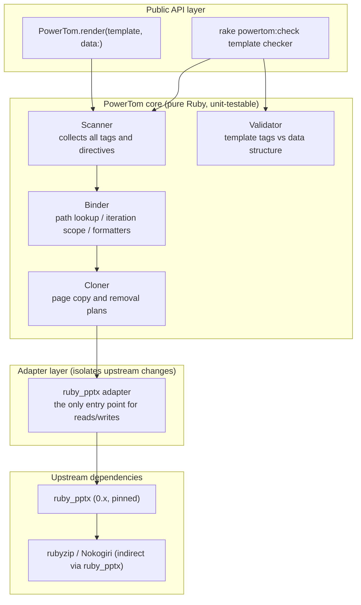

# PowerTom: Ruby PPTX template engine · project design document

> Name PowerTom, module `PowerTom`, gem name `powertom`. Version v0.1 draft, 2026-11-16.

## 1. Project positioning

### 1.1 One-sentence positioning

Designers maintain the template in PowerPoint; engineers pass a Ruby Hash and get a finished deck. Layout, fonts, masters and theme stay entirely under the design tool's control; the code only "scans tags, binds data and clones pages".

### 1.2 Problems to solve

Ruby's ecosystem has two kinds of existing PPTX generation, and neither fits "reuse the design asset":

| Approach | Examples | Problem |
| --- | --- | --- |
| Code-driven | `powerpoint`, `ruby_slides`, `caracal` (same idea for docx) | Layout is hard-coded; a designer changing one font size has to go through engineering |
| Low-level libraries | `ruby_pptx` (released 2026-09, a python-pptx port), `rbpptx` (released 2026-04, read/write only) | XML-level building blocks with no template layer; designers cannot reasonably work with code |

In the JS world, Carbone and Docxtemplater have proven real commercial demand for "template + JSON data → PPTX"; Ruby has no equivalent. PowerTom fills that layer: a **template engine standing on the shoulders of ruby_pptx**, without parsing OOXML itself.

### 1.3 Non-goals (explicitly out of scope for v1)

- No "declaratively build a whole deck in code" (already covered by ruby_pptx's `Pptx.build`)
- No PPT → PDF conversion (left to LibreOffice headless)
- No reading/writing the legacy PPT (97-2003 binary) format; OOXML .pptx only
- No collaborative editing, comments or other productised features

## 2. Core abstractions and target API

### 2.1 Render entry point

```ruby
require "powertom"

result = PowerTom.render(
  "templates/annual_report.pptx",
  data: {
    title: "2026 annual summary",
    quarter: "Q4",
    kpis: [
      { name: "Adoption rate", value: "29.7%", delta: "+3.2pt" },
      { name: "Monthly active campuses", value: "86", delta: "+12" }
    ],
    show_outlook: true
  }
)

result.save("out/annual_report_2026.pptx")
result.warnings.each { |w| puts w }   # unused fields, truncated text, etc.
```

### 2.2 Data model conventions

- The top level is an arbitrarily nested Hash / Array / scalar; Strings use `to_s`, numbers use `to_s` (formatting is left to template formatters, see 3.4)
- nil values: text tags render as an empty string; conditional tags treat nil as falsy
- Dates and times: accept `Date` / `Time` / `DateTime`; formatting is decided by the formatter

### 2.3 Error model

| Situation | Behaviour |
| --- | --- |
| The template references a field absent from the data | Raises `PowerTom::MissingDataError` by default (with slide number and text box name); with `strict: false`, degrades to an empty string and records a warning |
| The data has fields the template does not use | Records a warning; no error |
| Tag syntax error (for example `{{each kpis}}` missing `#`) | Raises `PowerTom::TemplateSyntaxError` during the pre-render scan |
| ruby_pptx cannot open the file / it is not a pptx | Wrapped and re-raised as `PowerTom::InvalidTemplateError` |

Error messages always carry location: slide number, shape (`name` attribute) and the original tag text. This is the key to designers using a template engine independently.

## 3. Template syntax specification (v0)

### 3.1 Design principles

1. **Directives in notes, tags in the body**: notes are invisible during a presentation but visible to the designer while building, so they never pollute the artwork
2. A single delimiter form `{{ }}`; no full Jinja2/ERB control flow
3. A tag inherits the style of the run it is written in. The placeholder's style is the output style

### 3.2 Text tags

```text
{{title}}
{{kpis[0].value}}
```

Only dot paths and indices are supported; no method calls, expressions or pipes. The path mirrors the data structure, so template review can reconcile by eye.

### 3.3 Page directives (written in slide notes)

```text
{{#each kpis}}      # clone the whole page per array item; tags on the page use each iteration's scope
{{#if show_outlook}}  # remove the whole page when falsy
```

- One directive per notes page; more than one is an error during the scan
- `#if` may coexist with any tags other than `#each`
- Ordinary text tags may still be written in notes (cases that need rendered notes are rare; not supported in v0, a warning is recorded)

### 3.4 Formatters (optional, phase 2)

```text
{{price:currency}}
{{ratio:percent.1}}
{{date:year_month}}
```

The word after the colon maps to a formatter proc registered on the Ruby side. Four built-in families: currency / percent / number / date, plus user registration. Not in v0: the caller does its own `to_s`.

## 4. Architecture



Layering:

- **Scanner / Binder / Validator never touch XML**; inputs and outputs are plain Ruby structures (tag AST + data), so they unit-test quickly
- The adapter layer is the only place that imports `ruby_pptx`. The upstream API will change before 1.0, and those changes stay locked in one module
- Render pipeline: scan (collect tags across the file) → validate/reconcile → build an "edit plan" (which text to replace, which pages to clone, which pages to remove) → execute once through the adapter → save

## 5. Technical notes and known pitfalls

### 5.1 Run splitting (pitfall #1)

PowerPoint stores `{{title}}` across several runs: IME composition, spell check and repeated editing all trigger it. The symptom is `{{ti` + `tle}}` in two separate `<a:r>` elements.

Solution: concatenate all run text at **paragraph level** into one string, match tags with a regex, write the replacement back into the first run and clear the text of the remaining runs (keeping the run nodes themselves so style references survive). This had to be solved on day one in v0, with full test coverage.

### 5.2 Slide cloning

Cloning a slide requires: copying the slide part and notes part, rebuilding all relationships for the new part (pictures, media, notesSlide links), inserting a new `sldId` (new id and rId) into `presentation.xml`'s `sldIdLst`, and updating `[Content_Types].xml`.

Principle: leave these XML details to ruby_pptx as much as possible; PowerTom only declares "clone slide N K times per some array". **Checked against upstream 0.2.0 source: `Slides#add_table_pages` adds a page per `add(layout)` and builds a new table, with no slide-part copying; `Slides` also has no delete / duplicate.** Clone and delete therefore live in the adapter layer, built on `Opc::Part#relate_to / rels` + `Oxml::BaseElement#import`. Another implicit constraint: `next_slide_partname` names parts as `sldIdLst.size + 1`, so deleting pages without `renumber_slide_parts` collides with existing part names. When upstream lacks a capability, send a PR first; PowerTom does not hoard XML operations, to keep the adapter layer from leaking.

### 5.3 Picture replacement

Placeholder pictures are located by shape name or alt text (convention: name is `powertom:image:field_name`, optionally `powertom:image:field_name; mode=contain`). When replacing the media part, keep the extension and content type consistent. Two modes, decided per placeholder: **fill** (default) fills the shape and crops from the centre via ruby_pptx's crop attributes, with a warning when the image aspect differs by more than 20%; **contain** scales the image by `min(width ratio, height ratio)` and centres the fitted rectangle inside the frame, clearing any `srcRect` crop — the margins show whatever is behind the picture (slide background or another shape), and the adapter does not synthesise a background fill. Vector images keep their geometry in both modes. Invalid `mode=` values are reported by `check` and rejected at render time.

### 5.4 Chart data binding

**Implemented in v0.4.0 (single-plot families, combo) and v0.4.1 (scatter / bubble / radar)** — see [chart-binding-design.md](chart-binding-design.md) for the verified design and spike evidence.

Charts are located by naming convention (`powertom:chart:<field>` on the shape name or alt text) and the whole data set is replaced through ruby_pptx `Chart#replace_data`; bar/column, line, area, pie, doughnut, radar, combo, scatter and bubble charts all ride upstream directly (scatter/bubble need ruby_pptx >= 0.3.0, which rebinds `c:xVal`/`c:yVal`/`c:bubbleSize`). Cloned (`#each`) chart pages are deep-copied per page so clones never share data.

Guards: combo / scatter / bubble require the data's series count to equal the template's (a combo mismatch would silently add or remove plots upstream; XY series are matched by position); pie accepts exactly one series; unsupported kinds are rejected with a located error. Saving normalizes the chart XML (axis ids that upstream still emits negative, illegal radar `c:smooth`) so the output passes Microsoft's OpenXmlValidator. That normalization is a compatibility moat: it stays until a fixed upstream release is verified, then gets gated by `Pptx::VERSION` and only later deprecated — the adapter never assumes correct upstream output.

### 5.5 Fidelity acceptance

The output must open in PowerPoint without a "repair" dialog. CI strategy is layered: **L1** structural lint (`tools/ooxml_lint.rb`, run on golden outputs in specs — dangling `[Content_Types].xml` overrides / relationship targets are the top repair trigger and LibreOffice silently tolerates them), **L3** official schema validation (`tools/openxml_validator` via `.github/workflows/l3.yml`, a Windows runner running Microsoft's OpenXmlValidator; a hard gate), and **L4** LibreOffice headless PDF conversion with three assertions — conversion succeeds, the page count is correct, and a PDF text spot-check contains the expected values. LibreOffice is more lenient than PowerPoint, so a manual acceptance checklist remains (**L5**: for every new golden sample, open it once in real PowerPoint). Chart templates additionally need a per-clone-page "Edit Data" click to confirm no page shows another page's data.

### 5.6 Loop variables and shape conditions (0.8.0)

**Loop variables.** `{{@index}}`, `{{@index1}}`, `{{@first}}` and `{{@last}}` are read-only tags available in every loop the engine expands: `{{array[].field}}` rows, `#rows` blocks, `#grid` data rows and `#each` pages. The `@` sigil reserves a namespace that cannot collide with data fields. Resolution uses the **innermost** loop at that paragraph; the render pipeline carries a `loop_info: {index:, size:}` in the bind context, and `check` verifies the tag sits on a content row of the table plan (or on an `#each` page), so a header/total row is a located error instead of a blank cell.

**Shape conditions.** A shape (or its alt text) named `powertom:if:<field>` is deleted when the value is falsy. Conditions are evaluated after page cloning and before any binding, so a hidden group never triggers missing-field errors from its own tags; `check` reconciles the field with the same `#each` item semantics as pictures. Groups are removed whole, and descendants of an already-removed group are skipped.

### 5.7 Asset resolution and aggregates (0.8.0)

**Asset resolution.** Picture values are references. `PowerTom.configuration.asset_resolver` (or the per-render `asset_resolver:` argument) receives `(ref, {slide_no:, shape:, field:})` and returns a local path or `{data: <binary>, extension: "<ext>"}`. The adapter materialises bytes into a temp file only for the duration of `replace_image`, so `ruby_pptx` keeps its existing image-part path. No HTTP client is built in: the application's resolver is the trust boundary, and `check` validates the same return shape.

**Aggregates.** `{{array[].field:sum}}` / `:avg` / `:min` / `:max` and `{{array[]:count}}` are formatter-shaped but resolved by the binder before scope resolution: split at `[]`, resolve the array against the page (or `#each` item), read the field per item, skip nils, and return a number. `check` performs the same traversal and rejects non-numeric fields. Table structure detection explicitly ignores aggregate tags, so a total row is not mistaken for a loop row.

## 6. Milestones

| Phase | Content | Acceptance |
| --- | --- | --- |
| M0 · week 1 | Dissect the run structure of a real pptx; get ruby_pptx reads/writes working; reproduce run splitting | A 50-line script: read a template, replace one tag, open normally in PowerPoint |
| M1 · weeks 2-3 | Scanner + Binder + paragraph-level run merge/replace; golden sample 1 (single page, multiple tags) | Golden sample renders in CI; tags split across runs are still replaced |
| M2 · weeks 4-6 | `#each` page cloning, `#if` page removal; error model and location info | Golden sample 2 (loop pages) passes; errors carry slide number and shape name |
| M3 · weeks 7-8 | Validator reconciliation + `rake powertom:check` + warnings | Bad templates fail in CI, and errors guide designers to self-diagnose |
| M4 · weeks 9-10 | Picture replacement; formatters; dogfooding: one real export scenario in a company product | Real business output, with template changes needing no developer involvement |
| v0.4.0 – v0.4.1 | Chart data binding: single-plot families, combo, scatter / bubble, radar; schema normalization; L3 official validation | All chart families bind; L3 validates every golden deck clean |
| After 1.0 | Docxtemplater compatibility layer (evaluation), standalone site and docs | Scheduled by dogfooding feedback |

Between milestones, completeness of the library is not the goal; every phase should produce something "that can really be used".

## 7. Template checker (the differentiating core)

Competitors generally treat validation as a by-product of logging; PowerTom makes it a first-class citizen:

- **`powertom:check`** takes a template + one sample data set (or a data schema) and outputs a human-readable report: every issue names "slide X, shape Y, tag Z, expected data path"
- The report has two levels: error (referenced a missing field, directive syntax error) blocks rendering; warning (unused fields, suspected placeholder overflow) does not
- Ships a Template Guide for designers: master usage conventions, suggested placeholder lengths (with autofit off, overflowing text is not clipped), naming convention `powertom:image:*`
- The designer-facing "template lint" is the most sustainable differentiator versus JS competitors; the guide itself is part of the moat

### 7.1 The checker never raises

`check` is a CI gate. Its value peaks exactly when the template is worst, and
that is when the tool must still produce a report instead of a backtrace. The
contract is therefore: **`check` returns a `CheckResult` for every input.**

Concretely, these are reported as errors with a location, never as exceptions:

| Input | Reported as |
| --- | --- |
| Empty tag (`{{}}`, `{{ }}`) | `TemplateSyntaxError`-level entry: "is not a valid tag; a tag needs a path" |
| Placeholder with no field name (`powertom:chart:`, `powertom:image:`, `powertom:if:`) | "chart/image/conditional placeholder has no field name" |
| Sample data that is not a Hash (e.g. a JSON array at the top level) | "sample data must be a Hash of top-level fields" |
| `{{#each path}}` where the path is missing, `nil`, or not an array | "expected an array, got NilClass" / a missing-field error |
| Formatter with an unsupported argument (`{{d:date.bogus}}`) | "formatter spec 'date.bogus' is invalid: ..." |
| Formatter bound to a value of the wrong type (`{{amt:currency}}` with a String) | "requires a number, got String" |

The CLI adds a final `rescue StandardError` so a bug in the checker itself
still exits `2` (usage/input error) with a one-line message rather than a
stack trace.

### 7.2 The checker and the renderer share one rule set

"Check says OK but render fails" is the failure mode that destroys trust in a
template engine. The rules are therefore not duplicated:

- Path resolution goes through `PathResolver` for both.
- Chart data shapes go through the same XY/BUBBLE vs. ordinary split in both;
  a scatter chart on a `{{#each}}` page is validated against its own `points`
  shape, not against `categories`.
- Formatter arguments and value types are checked by calling `Formatter`
  itself (`Formatter.validate` / `Formatter.validate_spec`), so a custom
  formatter registered with declared arguments is covered too.
- The asset resolver receives the same context in both paths:
  `{slide_no:, shape:, field:}`.
- A page-level `{{#each}}` combined with a table row loop is refused by both.

### 7.3 Windows file locking

`rubyzip` 3.x keeps no handle in `Zip::File` itself, but every
`Zip::InputStream` it hands out opens an independent handle through
`::File.open`; `get_input_stream` without a block never closes it, so the
handle survives until the GC finalizer runs. On Windows an open handle means
the file cannot be deleted, renamed or overwritten — the template stayed
locked after a render, and the suite reported 19–36 randomly distributed
`Errno::EACCES` failures that moved with the random seed.

The rules the codebase follows:

- Every zip read passes a block (`get_input_stream(&:read)`).
- Read a whole container through `Zip::File.open_buffer` over a `StringIO`
  rather than `Zip::File.open(path)`: the file handle then exists only for the
  duration of the read.
- Keep intermediate rewrites in memory and return bytes, so no temporary file
  and no `Tempfile` finalizer race (`Tempfile.new` defers `File.unlink` to GC
  on Ruby 4.0) can occur.
- Use `Tempfile.create` (a plain `File`, no finalizer) and unlink explicitly.

Verification: the suite runs clean on Ruby 4.0.9 across four random seeds,
and the rendered decks are opened with Microsoft PowerPoint 16 through COM
automation — no repair dialogue, and `Presentation.Saved == -1` (PowerPoint
did not modify the file, i.e. it considers the structure valid). L3
(`tools/openxml_validator` on a Windows runner) remains the hard gate for
schema-level violations.

## 8. Testing and quality strategy

- **Golden fixtures**: produced in real PowerPoint, covering: single page with multiple tags, tags split across runs, loop pages, conditional pages, Chinese fonts, chart pages (included since v0.4.0; the committed mini golden carries a chart page, the L3 deck set covers every chart family). Each golden sample = template + data + assertions (page count, key text, LibreOffice PDF conversion succeeds)
- **Unit layer**: Scanner / Binder / Validator do no file I/O, pure structure in and out, target coverage > 90%
- **Double regression safety net**: LibreOffice headless conversion + `ruby_pptx` read-back assertions (a successful read-back proves the package structure is self-consistent)
- **Fuzzy inputs**: under `strict: false`, missing tags, nil data and empty arrays (a loop page should become 0 pages by removing the whole group) all need explicit semantics tests

## 9. Risks and mitigations

| Risk | Probability | Mitigation |
| --- | --- | --- |
| ruby_pptx is 0.x and its API changes | High | Single-file adapter isolation + pinned Gemfile versions + full golden-sample run on every upgrade |
| Upstream lacks slide cloning | Medium | Spike before M2; if lacking, send a PR to ruby_pptx (cloning is a common need, so upstream is motivated to accept it) |
| LibreOffice is more lenient than PowerPoint, so broken files slip through | Medium | Manually open golden samples in real PowerPoint; add a Windows/PowerPoint CI job if conditions allow |
| Designers ignore the guide and produce odd templates | Medium | Check tool + guide + errors that locate shape names, minimising self-diagnosis cost |
| Non-standard pptx saved by Keynote / WPS | Low | On open failure, explicitly say "please re-save with PowerPoint / LibreOffice"; no attempt at full compatibility |
| Fewer features than mature options such as Carbone | Certain | Clear positioning as part of the native Ruby ecosystem: one Gemfile line in Rails, no Node dependency, no external service |
| Name collides with existing products in search | Certain | Always use the combined phrases `PowerTom ruby` / `PowerTom pptx` in outward copy; the README title carries product name, domain word and language; see §10 |

## 10. Naming, search and compliance

- Module name `PowerTom`, gem name `powertom` (lowercase, following RubyGems convention, `require "powertom"`). Checked on RubyGems: both `powertom` / `power_tom` were available
- **Origin of the name**: "The Tom in PowerTom is a dedication — left unexplained, on purpose." That wording is authoritative. It appears in three places, never above the fold: a "Why PowerTom" section at the end of the README, one line in the 0.1.0 CHANGELOG, and an optional tagline sub-line
- **Known cost**: `power tom` is a drum-kit term in English (a deep tom drum), and search results are dominated by drum bags, TomTom's "Tom" voice assistant and gaming peripherals; `PowerTom` also differs from Microsoft PowerToys by only a few letters. So do not rely on bare-word search; always use combined phrases in outward copy
- **Trademark boundaries**: not affiliated with Microsoft or TomTom. Keep a permanent line at the top of the README: "Not affiliated with Microsoft or TomTom." Do not borrow the visual language of Microsoft's Power family (Power BI / PowerToys etc.), to avoid being read as official or semi-official
- The name does not describe the function; the tagline carries the outward meaning: `PowerTom — PowerPoint template engine for Ruby`; the README's first screen should hold a 30-second gif: template (designer view) → one terminal command → finished deck
- **Visual identity**: the logo uses restrained marks — an initial, a dot, or a typographic treatment — with no cartoon mascot, to avoid reading as a toy and avoid confusion with drum hardware or TomTom
- MIT licence; no vendoring of upstream template files (ruby_pptx's NOTICE states its templates come from python-pptx; PowerTom's golden samples are all self-made, avoiding secondary attribution issues)
- Release cadence: 0.1.0 after M3 (read-only replacement + checker), no releases during dogfooding, semantic versioning after M4

## 11. Open questions

1. Should nested loops (arrays inside arrays, cloning the whole page per level) be supported in v0? Leaning no: placing directives in notes naturally supports only one page-level loop
2. ~~Should table row-level loops make 1.0?~~ **Resolved (shipped in 0.2.x–0.9.x)**: `{{array[].field}}` row loops, paired `{{#rows}}…{{/rows}}` blocks (3 levels), `{{#grid}}` dynamic columns and `{{#cols}}` bands are all implemented — see `docs/usage.md` §4 and `docs/table-loop-design.md`
3. ~~Which dogfooding scenario?~~ **Resolved**: scenario A (score analysis report export), realised as the 9-page v2 deck in `examples/score_report/`; see `docs/dogfooding-plan.md` and `docs/dogfooding-retrospective.md`
4. ~~Rails generator + rake task templates?~~ **Resolved (evaluated no)**: no railtie/generator; the whole integration is documented as a 10-minute checklist in `docs/usage.md` §11. Evaluation: `docs/evaluation-after-1.0.md`
